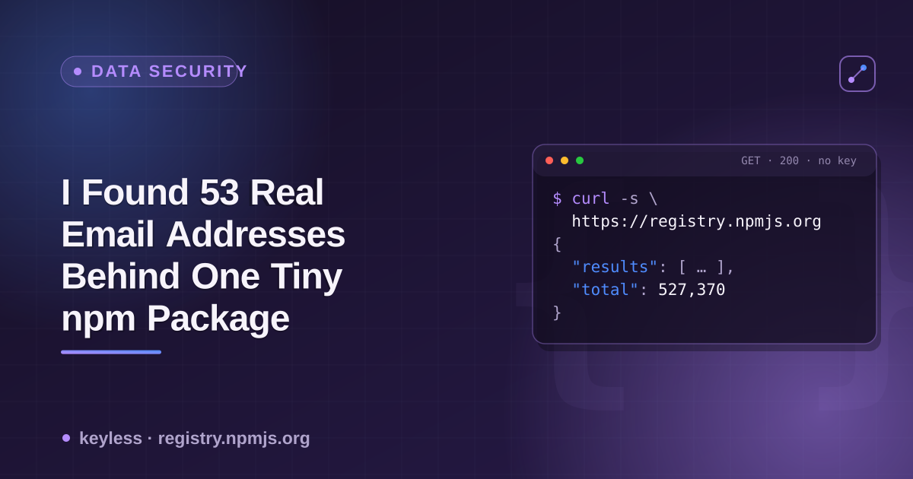

# package-contact-exposure



Every major 2025/2026 npm supply-chain incident started the same way: someone
phished a maintainer. This is the reference sheet for the step before that —
which registry hands you a maintainer's real contact info for free, and
which one structurally can't.

## The check, per registry

| Registry | Endpoint | Field | What's typically in it |
|---|---|---|---|
| npm | `GET https://registry.npmjs.org/{name}/latest` | `maintainers[].email` | Real, individually attributable emails — personal (Gmail/iCloud) and corporate, one entry per maintainer, no auth required |
| PyPI | `GET https://pypi.org/pypi/{name}/json` → `info` | `author_email`, `maintainer_email` | Inconsistent: some projects use a shared team address, others a maintainer's personal email, some leave it blank |
| crates.io | `GET https://index.crates.io/{shard}/{name}` (sparse index) | — | No email, author, or owner field exists in the schema at all |

crates.io's separate REST API (`crates.io/api/v1/crates/{name}/owners`, not the
sparse index) may expose GitHub login/avatar for owners — ownership there is
tied to GitHub OAuth identity, not a registered email — but that endpoint
wasn't reachable to confirm firsthand from every environment this was checked
from. Treat that one row as the least-verified claim here.

## Live examples (checked 2026-10-26)

```bash
# npm — maintainer emails, no auth needed
curl -s https://registry.npmjs.org/ms/latest | python3 -c \
  "import json,sys; m=json.load(sys.stdin)['maintainers']; print(len(m), 'maintainers'); [print(x['name'], x['email']) for x in m[:5]]"
# 53 maintainers — personal Gmail/iCloud addresses plus several corporate
# (@vercel.com, @google.com) ones, for a small time-parsing utility.

# PyPI — inconsistent: team address vs. personal address
curl -s https://pypi.org/pypi/flask/json | python3 -c \
  "import json,sys; d=json.load(sys.stdin)['info']; print(d['maintainer_email'])"
# Pallets <contact@palletsprojects.com>  — a shared team address

curl -s https://pypi.org/pypi/requests/json | python3 -c \
  "import json,sys; d=json.load(sys.stdin)['info']; print(d['maintainer_email'])"
# Ian Stapleton Cordasco <graffatcolmingov@gmail.com>, Nate Prewitt <nate.prewitt@gmail.com>
# — real, named personal addresses

# crates.io — nothing to find
curl -s https://index.crates.io/se/rd/serde | head -1
# no email/author/owner key anywhere in the JSON line
```

## A quick self-check script

```bash
#!/usr/bin/env bash
# usage: ./check-npm-emails.sh <package-name>
pkg="$1"
curl -s "https://registry.npmjs.org/${pkg}/latest" | python3 -c "
import json, sys
d = json.load(sys.stdin)
m = d.get('maintainers') or []
print(f\"{len(m)} maintainer(s) on {d.get('name')}:\")
for x in m:
    print(' -', x.get('name'), '<' + str(x.get('email')) + '>')
"
```

Run it against any npm package you maintain or depend on to see exactly what's
public right now.

## Why this is worth checking

Three documented incidents, all starting with a phished maintainer, not a
broken dependency:

| Date | Package(s) | Vector |
|---|---|---|
| 2026-06 | 144 packages, Mastra ecosystem | Maintainer account phished |
| 2025-09 | 18-20 packages (incl. widely-used ones, ~2-2.6B weekly downloads combined) | Lookalike domain `npmjs.help` phished 2FA ("Qix" incident) |
| 2025-07 | `eslint-config-prettier` and related | Lookalike domain `npnjs.com` phished credentials |

None of these are confirmed to have started from a registry-scraped email
specifically — a target list can come from GitHub profiles just as easily.
But the registry is one more free, zero-effort source for that list, and
unlike a GitHub profile, there's no way to opt out of it short of publishing
under an address you're fine being permanently public.

## Mitigation, for maintainers

- **Use a role/alias address**, not your primary personal inbox, for the
  account you publish packages from (npm and PyPI both allow changing the
  account email independent of what's already baked into old package
  versions — old published versions keep whatever email was current at
  publish time).
- **Enable phishing-resistant 2FA** (WebAuthn/security key, not SMS or
  TOTP-only) — the actual mechanism Qix-style attacks exploit is the 2FA
  step, not just knowledge of the email.
- **crates.io's GitHub-identity model is the structurally safer default**
  here, for whatever that's worth if you're choosing where to publish a new
  project and contact-info exposure is one of your criteria.

## Why this actor

[`package-registry-scraper`](https://apify.com/ponderable_hydrometer/package-registry-scraper)
normalizes npm, PyPI and crates.io into one output shape — name, version,
license, repository, dependency count — so cross-registry checks like this
one don't need three separate API clients.

## Related

- [`package-maintainer-data`](https://github.com/noble-ronin/package-maintainer-data) — which field carries *enforced* ownership (not just contact info) per registry.
- [`package-hallucination-check`](https://github.com/noble-ronin/package-hallucination-check) — checking whether an AI-recommended package name is real, a decoy, or a cleaned-up attack.
- Pairs with the dev.to article: [I Found 53 Real Email Addresses Behind One Tiny npm Package](https://dev.to/ronin13/i-found-53-real-email-addresses-behind-one-tiny-npm-package).
